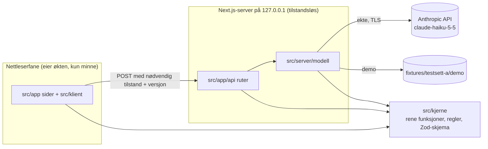
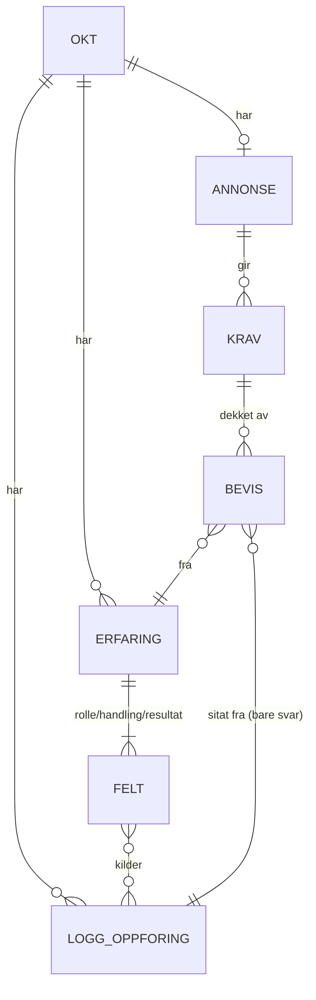

# Arkitektur-spine: Erfaringsgruven

## Designparadigme

**Funksjonell kjerne / tynt skall.** Alt som *avgjør* noe er rene funksjoner i `src/kjerne/`, uten nettverk, tilstand eller I/O. Skallet består av React-klienten, som eier økten, Next.js API-rutene, som er tilstandsløse mellomstasjoner, og modelladapterne for Anthropic og demo. Modellen *foreslår*, kjernen *bestemmer*.



Pilene viser lovlig avhengighetsretning. `kjerne` importerer ingenting fra `app`, `klient` eller `server`. `klient` importerer aldri `server`, og alle moduler i `server/` importerer `server-only`.

## Invarianter og regler

### AD-1: Next.js (App Router) er rammeverket [ADOPTED]

- **Binds:** all kode
- **Prevents:** to separate oppsett, og at API-nøkkelen havner i klientbundlen
- **Rule:** Ett Next.js-prosjekt. Alle kall til Anthropic skjer i API-ruter med `runtime = 'nodejs'`. Bare `src/server/` leser `ANTHROPIC_API_KEY`. Forbehold: Å-1.

### AD-2: Serveren er tilstandsløs, og økten lever bare i fanens minne [ADOPTED]

- **Binds:** alle API-ruter, klienttilstand, PRD §5, §6.2
- **Prevents:** at tilstand legges på serveren mens noen antar at klienten eier den, og at persondata blir liggende igjen
- **Rule:** API-ruter husker ingenting mellom kall, og klienten sender med det ruten trenger. Ingen `localStorage`, `sessionStorage`, IndexedDB eller informasjonskapsler med øktinnhold. Cache Components er slått av, og API-ruter caches aldri. Når siden lastes på nytt, er økten tapt og studenten lander på Start.

### AD-3: `beforeunload`-varsel beskytter økten [ADOPTED]

- **Binds:** klientskallet
- **Prevents:** ulik varsling på ulike flater, og at studenten mister økten ved et uhell
- **Rule:** Varselet er aktivt fra første studentsvar til økten tømmes. Det dekker både ny lasting og lukking. Nettleserens standardtekst brukes.

### AD-4: Én eier av klienttilstanden [ADOPTED]

- **Binds:** alle komponenter, FR-3
- **Prevents:** kopier av øktdata som glir fra hverandre
- **Rule:** Hele økten ligger i én `useReducer` med Context (`src/klient/okt/`), og all endring skjer gjennom navngitte handlinger i én reducer-fil. Komponenter har bare egen tilstand for UI som ikke er økten (utkast i inputfelt, åpne paneler).

### AD-5: Samtaleloggen kan bare utvides, og reduceren tildeler alle ID-er [ADOPTED]

- **Binds:** FR-2, FR-3, FR-6, Oppsummering, «Vis i samtalen», testsett A
- **Prevents:** at sitater mister kilden, at ID-er kolliderer eller gjenbrukes, og at modellen finner på ID-er
- **Rule:**
  - Loggoppføringer endres og slettes aldri. Typene er `sporsmal` (assistent, `A…`), `svar` (student, `S…`) og `rettelse` (student, `R…`).
  - **Bare `svar` (`S…`) kan siteres.** En `rettelse` registrerer en endring på Oppsummering (hele den nye felteksten, `erfaringId` og `felt`). Den brukes bare til koblingen og eksportens oppsummering, aldri som sitat. Det lages bare én oppføring når teksten faktisk endres. Ny informasjon må sies i samtalen for å kunne siteres.
  - Reduceren tildeler *alle* ID-er (`A`, `S`, `R`, `E`, `K`) fra en egen teller per prefiks i `okt.tellere`. Tellerne øker bare, og ID-er gjenbrukes aldri, heller ikke etter sletting.
  - Modellen refererer bare til ID-er den har fått. Nye erfaringer foreslås med midlertidige referanser (`{ ny: "n1" }`), og reduceren gir dem `E`-ID. Ukjente ID-er forkastes.
  - Å slette et erfaringskort fjerner ikke oppføringer fra loggen.

### AD-6: Sitater verifiseres ordrett før de forlater serveren [ADOPTED]

- **Binds:** FR-5, FR-6, SM-5, SM-C1
- **Prevents:** sitater som er skrevet eller omformulert av modellen, at sjekken gjøres ulikt, og at bevis peker på feil erfaring
- **Rule:**
  - Modellen foreslår `{ kravId, erfaringId, svarId, sitat }`. `verifiserSitat()` i kjernen godtar bare når `normaliser(sitat)` er en delstreng av `normaliser(tekst)` for en `svar`-oppføring. Den returnerer `{ svarId, start, slutt }` i originalteksten.
  - `normaliser()`: Unicode NFC, alle mellomromsløp (også NBSP og linjeskift) blir ett mellomrom, og teksten trimmes. Store og små bokstaver skilles.
  - Beviset forkastes også hvis `erfaringId` er ukjent eller slettet, eller hvis `svarId` ikke er blant erfaringens `kilder`.
  - Sjekken kjører i API-ruten i begge moduser. Sitatet som vises og eksporteres, klippes alltid ut av loggen ved hjelp av `start`/`slutt`, aldri fra modellens streng.
  - **Begrensning:** sjekken fanger bare sitater som ikke er ordrette. Ordrette, men feil koblinger (`forbudte_bevis`) fanges av promptkvalitet og evalueringstester.

### AD-7: Kjernen utleder status, ikke modellen [ADOPTED]

- **Binds:** FR-2, FR-3, FR-7, SM-6
- **Prevents:** at «fanget» og «dekket/hull» beregnes ulikt i UI, eksport og tester
- **Rule:**
  - En erfaring er **fanget** når `rolle`, `handling` og `resultat` hver har ikke-tom `tekst` og minst én gyldig kilde. En kilde er gyldig når den peker på en eksisterende `svar`-oppføring (`erFanget()`).
  - Et krav er **dekket** når det har minst ett bevis som består AD-6, ellers er det **hull**.
  - Modellen returnerer et `refleksjonsforslag` for hvert krav. Mangler det, setter kjernen inn en standardtekst i UX-stemmen («Tenk på: …»).

### AD-8: Koblingen bruker rettet tekst, og sitatene bruker loggen [ADOPTED]

- **Binds:** FR-3, FR-5, FR-8
- **Prevents:** at en rettelse endrer et sitat, eller at koblingen ignorerer rettelser
- **Rule:** `felt.tekst` (som kan være rettet) og `rettelse`-oppføringer brukes til koblingen mot krav og i eksportens oppsummering, men siteres aldri. Sitater kommer bare fra `svar`-oppføringer (AD-5, AD-6).

### AD-9: Én API-kontrakt, og skjemaene er definert én gang [ADOPTED]

- **Binds:** alle API-ruter, klient og tester
- **Prevents:** at klient, rute og modellsvar får ulike former
- **Rule:**
  - Rutene er `POST /api/samtale`, `POST /api/krav`, `POST /api/bevis`, `GET /api/status` (`{ harNokkel, harDemodata }`) og `GET /api/demo/manus`.
  - Alle forespørsler, svar og strukturerte modellsvar er Zod-skjemaer i `src/kjerne/skjema.ts`, og alle importerer derfra.
  - Modellen kalles med `client.messages.parse` og `output_config.format`, som avledes fra det samme skjemaet. Rutens egen Zod-validering er autoritativ.
  - Ingen strømming i v1. En tom kravliste er et gyldig resultat og ikke en feil.

### AD-10: Demomodus kobles inn bak modellgrensesnittet [ADOPTED]

- **Binds:** FR-9, SM-7
- **Prevents:** en egen demovei som glir bort fra den ekte, og at demoen kommer ut av takt
- **Rule:**
  - `src/server/modell/` har ett grensesnitt med `AnthropicModell` og `DemoModell`. Hver forespørsel har `modus: "ekte" | "demo"`, og `"ekte"` uten nøkkel gir `mangler_nokkel`.
  - `DemoModell` velger lagret svar ut fra steget (ruten) og antall `svar`-oppføringer i loggen den mottar. Klienten finner neste manussvar fra den samme tellingen i reduceren og holder ingen egen indeks.
  - Den eneste forskjellen i klienten er hvor input kommer fra («Neste»). I demo er annonsen låst til testannonse A.
  - Med nøkkel tilbys begge moduser, uten nøkkel bare demo.

### AD-11: Demodata ligger adskilt fra fasiten [ADOPTED]

- **Binds:** `fixtures/`, FR-9, testene
- **Prevents:** at «hva modellen sa» blandes med «hva som er riktig»
- **Rule:** Lagrede modellsvar ligger i `fixtures/testsett-a/demo/`, og fasiten ligger i `fasit.json`. Demosvarene har ett bevisst falskt sitat som *eneste* bevis for K5, slik at AD-6 synlig gjør K5 til hull. README forklarer hva sensor skal se etter.

### AD-12: Persondata logges aldri [ADOPTED]

- **Binds:** API-ruter, modelladaptere, PRD §5
- **Prevents:** at svartekst eller sitater havner i terminal, filer eller feilmeldinger
- **Rule:** Logger og feilsvar inneholder bare ID-er, feilkoder og Zod-stier (`issue.path`, `issue.code`), aldri mottatte verdier, svar-, sitat- eller annonsetekst.

### AD-13: Samtaleruten returnerer endringer, og reduceren fletter dem inn

- **Binds:** FR-2, FR-3, `/api/samtale`, Oppsummering
- **Prevents:** at modellen overskriver studentens rettelser, at slettede kort kommer tilbake, og at titler får to eiere
- **Rule:**
  - `/api/samtale` returnerer `{ sporsmal, endringer[] }`. Mulige endringer er `opprett` (`ny`, `tittel`), `leggTilKilde` (`erfaringId | ny`, `felt`, `svarId`) og `settTekst` (`erfaringId | ny`, `felt`, `tekst`).
  - Reduceren bruker kjernefunksjonen `brukEndringer()`. Den ignorerer endringer på slettede erfaringer (`okt.slettedeErfaringer`) og overskriver aldri `tekst` eller `tittel` som er merket `rettetAvStudent`. Modellen setter tittelen bare når kortet opprettes.
  - Feltformen er `{ tekst, kilder: svarId[], rettetAvStudent }`, samme navn som i testsett A.

### AD-14: Nullstilling etter avhengighet, og svar som kommer for sent forkastes

- **Binds:** «Gå tilbake og endre», «Ny økt», alle kall
- **Prevents:** at steg nullstilles ulikt, og at et sent `/api/krav`- eller `/api/bevis`-svar fyller en økt som er nullstilt
- **Rule:**
  - `nullstill()` i kjernen bestemmer hva som tømmes. En endret erfaring eller en fortsatt samtale tømmer bevistabellen. En endret annonse tømmer krav og bevistabell. Annonseteksten tømmes bare ved «Ny økt».
  - `okt.versjon` øker ved hver nullstilling og ved «Ny økt». Hver forespørsel tar med versjonen den ble sendt fra, og reduceren forkaster svar med en eldre versjon.

### AD-15: Modellkall har én vei, faste grenser og én feilmodell

- **Binds:** `src/server/modell/`, alle ruter, kostnad (PRD §5)
- **Prevents:** at noen prøver på nytt flere steder, at feil håndteres ulikt, og ukontrollert kostnad
- **Rule:**
  - Alle kall går gjennom `anthropic.ts`. Timeout, SDK-ens `maxRetries` og `max_tokens` per steg settes i `config.ts`. Rutene prøver aldri på nytt selv, og klienten prøver bare på nytt når brukeren trykker «Prøv igjen».
  - Ingen `temperature`, `top_p` eller `top_k`. Disse er fjernet i API-versjonen som SDK 1.x bruker, og atferden styres med prompten.
  - 429/529, timeout og nettverksfeil gir `modell_feil` (503). Ugyldig strukturert svar gir `ugyldig_svar` (502). Øvre grenser for annonse og logg står i `kjerne/regler.ts`, og brudd gir `ugyldig_foresporsel` (400).

### AD-16: Terskelregler står ett sted

- **Binds:** FR-1, FR-3, FR-4, UI og ruter
- **Prevents:** at knapp og rute bruker ulike terskler
- **Rule:** `kjerne/regler.ts` eier `MIN_ANNONSE_TEGN = 200`, `MAAL_ERFARINGER = 3`, maksgrensene, `kanTrykkeFerdig()` (minst ett `sporsmal`) og `kanGaVidere()` (minst én fanget erfaring). Både UI og ruter bruker disse.

### AD-17: Personvernløftet sier bare det arkitekturen holder

- **Binds:** Start-flaten, PRD §5
- **Prevents:** at UI-teksten lover mer enn systemet gjør
- **Rule:** Appen lagrer ingenting (AD-2). Svar sendes kryptert (TLS) til Anthropic API for behandling. Trafikken mellom nettleser og lokal server forlater ikke maskinen (127.0.0.1). Starteksten skal si at svarene sendes til Anthropic, og skal ikke love noe om Anthropics lagring før det er sjekket (Å-3). Ordlyden eies av UX.

## Konsistenskonvensjoner

| Område | Konvensjon |
| --- | --- |
| Språk i koden | Fagbegreper på norsk uten æøå (ordliste nedenfor). Alt teknisk på engelsk. Tekst i UI på norsk med æøå. |
| ID-er | Strenger med prefiks `A1`, `S1`, `R1`, `E1`, `K1`, én teller per prefiks (AD-5). Testsett A konverteres ved lasting: `sporsmal` blir `A`-oppføringer. |
| Feilsvar | `{ feil: { kode, melding } }`. Kodene er `modell_feil` (503), `ugyldig_svar` (502), `mangler_nokkel` (400) og `ugyldig_foresporsel` (400). Klienten viser «Noe gikk galt. Prøv igjen.» og beholder input. |
| Modellkonfigurasjon | `src/server/modell/config.ts`: modell-ID, `max_tokens` per steg, timeout og `maxRetries`. |
| Prompter | `prompts/samtale.md`, `prompts/krav.md` og `prompts/bevis.md`, versjonert i git. Ingen prompttekst i koden. |
| Eksport | `lagEksport(okt)` i `kjerne/eksport.ts` er eneste eier av formatet og brukes både av «Kopier» og «Last ned .txt». |
| «Vis i samtalen» | Hver loggoppføring rendres med `id="logg-<svarId>"`. Markeringen bruker `start`/`slutt` fra AD-6. |
| Hemmeligheter | `ANTHROPIC_API_KEY` i `.env.local` (gitignored). `.env.example` er committet. |
| Dev-server | `"dev": "next dev -H 127.0.0.1"` i `package.json` |
| Tester | `tests/kjerne/` bruker Vitest mot testsett A uten nøkkel og kjøres alltid. `tests/eval/` kjører mot ekte modell (SM-4–SM-6, SM-C1), er valgfri og krever nøkkel. |

### Ordliste: kode ↔ PRD §3

| I koden | PRD-begrep | Merknad |
| --- | --- | --- |
| `okt` | Økt | Hele tilstanden i reduceren |
| `logg`, `loggOppforing` | Samtale | Kan bare utvides (AD-5) |
| `svar`, `svarId` | Samtalesvar | `S…`, det eneste som kan siteres |
| `rettelse` | (ny) | `R…`, rettelse fra Oppsummering, kan ikke siteres |
| `erfaring`, `rolle`, `handling`, `resultat`, `kilder` | Erfaring (R-H-R) | `E…` |
| `annonse` | Stillingsannonse | Én per økt |
| `krav`, `kravuttrekk` | Krav, kravuttrekk | `K…` |
| `bevis`, `sitat` | Bevis | Verifisert etter AD-6 |
| `bevistabell`, `hull`, `refleksjonsforslag` | Bevistabell, hull | |
| `modus: "ekte" \| "demo"` | Demomodus | |

## Stack

| Navn | Versjon |
| --- | --- |
| Node.js LTS (må installeres) | 26.13.0 |
| Next.js (App Router, Cache Components av) | 16.4.5 |
| React | 19.3.1 |
| TypeScript | 5.x |
| Tailwind CSS | 4.3.4 |
| shadcn (CLI) | 4.23.0 |
| @anthropic-ai/sdk | 1.5.0 |
| Zod | 4.6.7 |
| Vitest (+ vite 8.3.5 som peer) | 5.1.0 |
| Språkmodell | claude-haiku-5-5 |

Sjekket mot npm, nodejs.org og Anthropics dokumentasjon 4. november 2026.

## Strukturelt utgangspunkt



```text
src/
  app/                # sider: Start, Samtale, Oppsummering, Annonse, Krav, Bevistabell
    api/samtale|krav|bevis|status|demo/manus/route.ts
  kjerne/             # skjema.ts, regler.ts, sitat.ts, fanget.ts, endringer.ts, nullstill.ts, eksport.ts
  klient/okt/         # reducer, Context, handlinger, tellere, versjon
  klient/             # komponenter
  server/modell/      # grensesnitt, anthropic.ts, demo.ts, config.ts, prompt-lasting
  components/ui/      # shadcn-genererte komponenter
prompts/
fixtures/testsett-a/  # student.json, annonse-a.md, fasit.json, demo/
tests/kjerne/  tests/eval/
```

**Oppstart av prosjektet:** Repo-roten har allerede filer, så `create-next-app` med `--src-dir` kjøres i en midlertidig mappe og flyttes inn. Deretter kjøres `shadcn init`, og dev-scriptet settes som i konvensjonene.

**Kjøremiljø:** bare lokalt, uten hosting, database eller CI i v1. README-oppskriften for sensor skal ta med: installer Node 26 LTS, kjør `npm install`, kopier `.env.example` til `.env.local` (valgfritt), kjør `npm run dev`, og forklaringen av demomodus og K5 (AD-11).

## Kart: krav → arkitektur

| Krav | Ligger i | Styres av |
| --- | --- | --- |
| FR-1 Start samtale | Start, Samtale, `/api/samtale` | AD-2, AD-4, AD-10, AD-16 |
| FR-2 R-H-R | `/api/samtale`, `kjerne/endringer.ts`, `fanget.ts` | AD-5, AD-7, AD-13 |
| FR-3 Avslutt og oppsummer | reducer, Oppsummering | AD-4, AD-7, AD-8, AD-13, AD-14, AD-16 |
| FR-4 Kravuttrekk | `/api/krav` | AD-5, AD-9, AD-14, AD-16 |
| FR-5 Kobling | `/api/bevis` | AD-6, AD-8 |
| FR-6 Sporbarhet | `kjerne/sitat.ts`, «Vis i samtalen» | AD-5, AD-6 |
| FR-7 Hull | `/api/bevis`, kjernen | AD-7 |
| FR-8 Eksport | `kjerne/eksport.ts` | AD-8, konvensjonen for eksport |
| FR-9 Demomodus | `server/modell/demo.ts`, `fixtures/testsett-a/demo/` | AD-10, AD-11 |
| PRD §5 Personvern og kostnad | hele skallet | AD-2, AD-3, AD-12, AD-15, AD-17 |

## Utsatt

- **Hosting/deploy, CI, rate limiting:** v1 kjører bare lokalt. Tas opp igjen hvis appen skal på nett.
- **Hvordan uttrukne krav matches mot fasiten (`nokkelord`):** bestemmes når `tests/eval/` skrives.
- **Konkrete verdier for `max_tokens`, timeout og maksgrenser:** settes i `config.ts` og `regler.ts` ved første kjøring mot testsett A. *Hvor* de står, er bundet.
- **Promptinnhold og antall oppfølgingsspørsmål (PRD Å.s. 1):** avgjøres ved iterasjon mot testsett A.
- **Flere annonser per økt (Å.s. 2), aktiv oppfølging av hull (Å.s. 3), strømming, mørk modus, mobiloptimalisering:** utenfor v1.
- **Intern komponentstruktur og sideoppsett:** eies av koden og UX-spinen.

## Åpne spørsmål

- **Å-1:** Krever IBE160 en bestemt stack? Rikke sjekker med gruppen før epics og stories. Påvirker AD-1.
- **Å-3:** Hva lagrer Anthropic API av data, og hvor lenge? Må sjekkes før startteksten skrives (AD-17).
