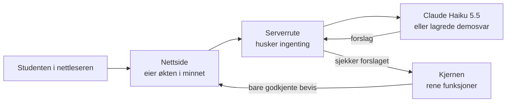

# Arkitekturen i Erfaringsgruven: valg og begrunnelser

*G134, 4. november 2026. Skrevet for gruppen og sensor.*

Dette dokumentet forklarer hvilke arkitekturvalg vi har tatt for Erfaringsgruven, hvilke alternativer vi vurderte, og hvorfor vi valgte som vi gjorde. Selve reglene står i [ARCHITECTURE-SPINE.md](ARCHITECTURE-SPINE.md), som er kort med vilje og brukes som grunnlag når vi bygger. Hver beslutning har en ID (AD-1, AD-2 …), og den samme ID-en brukes her, i epics og i stories. Hele beslutningsloggen ligger i [.memlog.md](.memlog.md).

## Hvorfor vi trenger arkitekturregler

Vi er tre personer som skal bygge hver vår del av appen, og mye av koden skrives med KI-hjelp. Den største risikoen er ikke at én del blir dårlig, men at delene ikke passer sammen. Én kan for eksempel lagre erfaringer på én måte mens en annen forventer en annen form. Arkitekturen fastsetter derfor bare de valgene der to personer ellers kunne valgt forskjellig. Resten bestemmes av koden underveis.

## Hovedideen: modellen foreslår, koden bestemmer

Erfaringsgruven lover studenten at alt som vises som bevis er hennes egne ord (PRD FR-5, SM-C1). En språkmodell kan omformulere eller dikte opp, så det løftet kan ikke hvile på modellen alene.

Vi bruker derfor mønsteret **funksjonell kjerne / tynt skall**:

- **Kjernen** er rene funksjoner som bestemmer alt viktig. De sjekker at et sitat finnes ordrett, avgjør når en erfaring er «fanget», hva som er dekket og hva som er hull, hva som skal nullstilles, og hvordan eksporten ser ut. Funksjonene bruker ikke nettverk og lagrer ingenting, så de kan testes mot testsett A uten API-nøkkel.
- **Skallet** er alt rundt: nettsidene, serverrutene og kallene til språkmodellen.

## Valgene

### 1. Next.js som rammeverk (AD-1)

API-nøkkelen til Anthropic må ligge på en server. Ligger den i nettleseren, kan alle som åpner siden se den.

| Alternativ | Vurdering |
|---|---|
| **Next.js** (valgt) | Frontend og serverruter i ett prosjekt og én kommando. Nøkkelen blir automatisk liggende på serveren. UI-biblioteket vi har valgt (shadcn/ui) har en ferdig mal for det. Det er godt dokumentert. |
| Vite + React og en egen Node-server | Tydelig skille mellom klient og server, men to deler som må kobles sammen og settes opp selv. |
| Bare nettleser | Enklest, men nøkkelen blir synlig. Forkastet. |

Ingen i gruppen har erfaring med noen av disse fra før, så vi valgte standardveien med mest dokumentasjon. *Åpent:* vi har ikke sjekket om kurset krever en bestemt stack (Å-1).

### 2. Ingen lagring, heller ikke midlertidig (AD-2, AD-3)

Serveren husker ingenting mellom kall. Hele økten lever bare i minnet i nettleserfanen. Lastes siden på nytt, er økten borte.

Vi vurderte å bruke nettleserens `sessionStorage`, slik at økten overlever at siden lastes på nytt. Vi forkastet det fordi Chrome og Firefox kan gjenopprette `sessionStorage` når nettleseren åpner tidligere faner. På en delt maskin kan da noen andres samtale dukke opp igjen, og det bryter løftet «Ingenting lagres når du lukker fanen». I stedet viser nettleseren et varsel før siden lastes på nytt eller lukkes, så lenge økten har innhold.

### 3. Sitater sjekkes av kode, ikke av modellen (AD-6)

Dette er det viktigste valget for produktet.

| Alternativ | Vurdering |
|---|---|
| Modellen skriver sitatet, og vi stoler på det | Modellen kan omformulere uten at noen merker det. Forkastet. |
| **Modellen foreslår svar-ID og sitat, og kode sjekker at sitatet står ordrett i det svaret** (valgt) | Et feil sitat blir forkastet, og kravet vises da som et hull. Feilen går i trygg retning. Sjekken kan testes automatisk. |
| Modellen oppgir tegnposisjoner, og koden klipper ut teksten | Ordrett per konstruksjon, men språkmodeller er dårlige til å telle tegn. Forkastet. |

Sjekken kjører på serveren før svaret sendes til nettleseren, så et ubekreftet bevis kommer aldri fram til studenten.

**Begrensning:** Sjekken fanger bare sitater som ikke er ordrette. Hvis modellen bruker et ekte sitat som bevis for feil krav, for eksempel en privat ferie som bevis for erfaring fra reiselivsbransjen, slipper det gjennom sjekken. Den feiltypen måles med fellene i testsett A (`forbudte_bevis`) og reduseres gjennom bedre prompter.

### 4. Samtalen kan bare utvides, og rettelser kan ikke siteres (AD-5, AD-8, AD-13)

Hvert svar fra studenten får en fast ID (`S1`, `S2` …), slik som i testsett A. Svar endres eller slettes aldri, slik at et bevis alltid kan spores tilbake til svaret det kom fra.

Studenten kan rette erfaringene sine på Oppsummering. Først foreslo vi at en rettelse skulle bli en ny loggoppføring (`R1` …) som også kunne siteres. Gjennomgangen viste et problem med det. Feltet studenten retter, inneholder allerede modellens oppsummering. Endrer studenten ett ord, består rettelsen likevel mest av modellens ord, og et sitat fra den ville blitt vist som «dine egne ord». Derfor:

- Rettelser lagres i loggen, slik at det er sporbart hva studenten endret.
- Rettet tekst brukes når krav kobles til erfaringer og i eksportens oppsummering.
- **Bare det studenten skrev i samtalen, kan siteres.** Vil studenten legge til noe nytt, sier hun det i samtalen («Fortsett samtalen»).

Modellen får ikke overskrive det studenten har rettet, og et kort studenten har slettet, kommer ikke tilbake.

### 5. Demomodus bruker samme vei som den ekte appen (AD-10, AD-11)

Sensor skal kunne prøve hele appen uten API-nøkkel (FR-9). Vi kobler demoen inn på serveren, der lagrede modellsvar erstatter den ekte modellen. Nettsiden og sitatsjekken fungerer likt i begge moduser.

Vi vurderte å la nettsiden hoppe direkte til ferdige resultater i demomodus. Det ville gitt to veier gjennom appen som kunne gli fra hverandre, og demoen ville ikke vist at sitatsjekken virker.

De lagrede demosvarene inneholder **ett bevisst falskt sitat** for felle-kravet K5 (reiselivsbransjen). Sitatsjekken avviser det, og K5 vises som hull. Slik kan sensor se at sjekken virker. README forklarer hva sensor skal se etter.

### 6. Én eier av tilstanden og faste regler for nullstilling (AD-4, AD-14, AD-16)

Hele økten styres fra ett sted i nettsiden (en React `useReducer`). Terskler som «minst 200 tegn i annonsen» og «3 erfaringer» står i én fil og brukes av både knappene og serveren.

Går studenten tilbake og endrer noe, tømmes bare det som avhenger av endringen. En endret erfaring gir ny bevistabell, og en endret annonse gir nye krav og ny bevistabell. Kommer et svar fra serveren etter at studenten har endret noe, forkastes svaret, slik at et gammelt resultat ikke vises.

### 7. Personvern, kostnad og feil (AD-12, AD-15, AD-17)

- Svar, sitater og annonsetekst skrives aldri til logger eller feilmeldinger, bare ID-er og feilkoder.
- Dev-serveren lytter bare på maskinen selv (127.0.0.1), slik at ingen andre på nettverket kan bruke API-nøkkelen.
- Startsiden skal si at svarene sendes kryptert til Anthropic for behandling. Den skal ikke love noe om hva Anthropic lagrer før vi har sjekket det (Å-3).
- Alle modellkall går gjennom én fil med faste grenser for svarlengde, tidsavbrudd og antall nye forsøk. Hvis noe feiler, ser studenten «Noe gikk galt. Prøv igjen.», og det hun har skrevet, beholdes.

### 8. Navn i koden

Fagbegrepene fra PRD-en skrives på norsk uten æøå i koden (`okt`, `erfaring`, `krav`, `bevis`, `hull`, `svarId`), og alt teknisk skrives på engelsk. Da bruker PRD, UX, testsett og kode de samme ordene. Spinen har en ordliste.

## Teknisk grunnlag

Versjonene ble sjekket mot npm og nodejs.org 4. november 2026: Node.js 26 LTS (må installeres), Next.js 16.4, React 19.3, Tailwind 4.3, shadcn 4.23, Anthropic SDK 1.5, Zod 4.6 og Vitest 5.1. Språkmodellen er Claude Haiku 5.5, valgt i PRD-addendumet.

Testene er delt i to:
- **Kjernetester** kjører mot testsett A uten nøkkel og kjøres alltid.
- **Evalueringstester** kjører mot den ekte modellen (SM-4–SM-6). De er valgfrie fordi de koster penger og gir litt forskjellige svar fra gang til gang.

## Slik ble arkitekturen kvalitetssikret

Spinen ble laget med BMAD-skillen `bmad-architecture` i coaching-modus. Rikke tok hovedvalgene, og KI-assistenten la fram alternativer og anbefalinger. Utkastet ble deretter gjennomgått av fire uavhengige KI-gjennomgangere:

1. Avstemming mot PRD, UX og testsett.
2. Sjekkliste for en god arkitektur.
3. Kontroll av at versjoner og verktøy er oppdaterte.
4. En «motstander» som prøvde å finne to deler som følger alle reglene, men likevel ikke passer sammen.

Gjennomgangen fant blant annet motsigelsen om rettelser (valg 4), manglende regler for ID-er, nullstilling og modellfeil, og at API-et ikke lenger godtar parameteren `temperature`. Alt er rettet. Rapportene ligger i [reviews/](reviews/).

## Det som gjenstår

- **Å-1:** Krever IBE160 en bestemt stack? Sjekkes før epics og stories.
- **Å-3:** Hva lagrer Anthropic API av data, og hvor lenge? Sjekkes før teksten på startsiden skrives.
- Konkrete grenser (svarlengde, tidsavbrudd, maksstørrelser) settes ved første kjøring mot testsett A.
